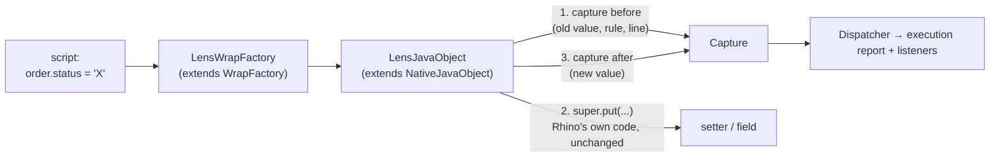
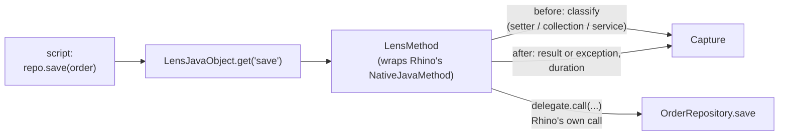

# How it works

## Scripts never touch Java objects directly

When a script uses a Java object, Rhino puts a **wrapper** around it, and every read, write and method call goes through that wrapper. The Rhino 1.6R5 source shows the path:

| Script code | Rhino's path |
|---|---|
| `order.status = "X"`, `order["status"] = "X"`, `with (order) { status = "X" }` | `NativeJavaObject.put` → bean setter or public field |
| `order.setStatus("X")`, `items.add(x)`, `repo.save(order)` | `NativeJavaObject.get` returns a `NativeJavaMethod`; its `call(...)` invokes the Java method |
| `tags[1] = "vip"` (Java array) | `NativeJavaArray.put(int)` |
| a raw Java object put in the scope (`scope.put("order", scope, order)`) | wrapped each time a script touches it, by the Context's `WrapFactory` |

## Lens extends those wrappers; it doesn't replace them

- **`LensJavaObject` extends `NativeJavaObject`.** It overrides only `put` and `get`, and both call `super`. Member lookup, overload resolution, type conversion and `unwrap()` are all Rhino's.
- **`LensMethod` wraps Rhino's `NativeJavaMethod`.** It holds Rhino's original method object and calls `delegate.call(...)`. There's one `LensMethod` per Rhino method object, so `obj.f === obj.f` behaves as in plain Rhino.
- **`LensJavaArray` extends `NativeJavaArray`.** It overrides only `put(int)`.
- **`LensWrapFactory` extends `WrapFactory`.** It hands out the Lens wrappers. If creating one fails, it hands out Rhino's plain wrapper.

**The real operation always runs once, unguarded and unchanged,** so a script's results and exceptions are exactly what they would be without Lens.

## How Lens reaches every Context

`Lens.install()` adds a listener to Rhino's global `ContextFactory`. Plain `Context.enter()` creates Contexts through that factory, which notifies the listener. On each new Context the listener:
1. installs `LensWrapFactory`, and
2. turns on `generatingDebug`, keeping the optimization level (see below).

`Lens.installAsGlobalFactory(config)` goes further and makes Lens Rhino's global factory. Rhino then calls its `doTopCall` for every top-level evaluation, so each evaluation becomes an execution with a report automatically. Rhino allows only one global factory per JVM.

## How Lens knows the rule and the line

| Mode | How |
|---|---|
| Interpreted (`setOptimizationLevel(-1)`) | Reads Rhino's own interpreter frame: the same place Rhino gets positions for its error messages. Cheap. |
| Compiled (0–9) | Walks the stack to the first frame of the class Rhino generated for the script (`org.mozilla.javascript.gen.c<n>`); that frame's file name is the script name and its line is the script line. |

**Why `generatingDebug` is turned on:** Rhino's compiler writes line numbers into generated classes always, but writes the script **name** only when `generatingDebug` is on. Lens turns it on when a Context is created. Setting it would normally drop the optimization level to 0, so Lens restores the level, and your code's own later `setOptimizationLevel(9)` also keeps it on.

The stack walk is the largest part of Lens's cost in compiled mode. You can switch it off with `lineNumbersInCompiledMode(false)`; see [performance](performance.md).

## Never breaking the script

Every piece of Lens's own work runs through `LensSafe`:
- the before/after capture, the getter calls for old and new values, rendering values, finding ids and positions
- dispatching to listeners, building reports

A failure in any of them is flagged and a safe fallback is used. See [failure handling](failure-handling.md).

## Not observing itself

While Lens captures or dispatches, a per-thread guard is set, and nothing that happens meanwhile is observed. That covers getters, listeners and anything a listener runs. Lens's own objects (reports, the script API) always get plain Rhino wrappers. See [loop safety](loop-safety.md).

## Source map

| Class | Role |
|---|---|
| `Lens` | Public entry point |
| `LensContextListener`, `LensContextFactory` | Instrument Contexts; automatic executions |
| `LensWrapFactory`, `LensJavaObject`, `LensJavaArray`, `LensMethod` | The wrappers |
| `Capture` | Before/after capture and event building |
| `ScriptPosition`, `org.mozilla.javascript.LensAccess` | Rule name and line |
| `Beans`, `Values` | Reading and rendering values |
| `LensSafe`, `Guard`, `LensDiagnostics` | Failure isolation and loop prevention |
| `ExecutionTracker`, `LensExecution`, `LensReport`, `Dispatcher` | Executions, reports and listeners |

`LensAccess` sits in Rhino's own package (the Rhino jar isn't sealed) only so it can call the package-private method Rhino uses to find the interpreter's position. It reads; it changes nothing.
